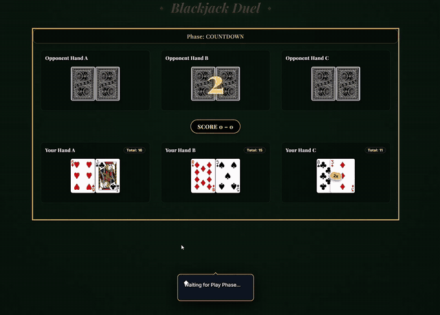

# Blackjack Duel

**Play the player, not the house.** A head-to-head Blackjack game where you bluff, read your opponent and spend two single-use abilities across three hands.



**▶ Play the 1v1 duel:** https://bjd-mp.onrender.com/ (open it in two tabs to play yourself)
**▶ Play King of the Hill:** https://bj-koth.onrender.com/

*Both run on a free tier, so give them a moment to wake up.*

## Why I built it

Blackjack against a dealer is a solved game. You play against probability, the house edge is fixed, and nothing you do changes who's sitting across the table. Plenty of players love its simplicity, and plenty of them get bored.

Poker has the opposite problem. It's a genuine skill game against real people, and that's exactly why a lot of players bounce off it: the rules are deep, sessions are long, and the regulars are far better than you.

I think there's a product in the gap between those two. Blackjack Duel keeps Blackjack's rules, which everyone already knows, and swaps the dealer for a person. Then it adds the thing Blackjack has never had: **bluffing**.

Nobody gave me a brief or a spec for this. I wrote the design, playtested the rules with a physical deck before writing any code, and then built the two demos to prove the loop works on screen.

## How it plays

Each player gets **three private hands**, A, B and C. Before anything is played, you get a timed Strategy Phase and two one-shot abilities:

- **Double** one hand to make it worth 2 points. It takes one more card and locks.
- **Redraw** one card in another hand.

Then you play the hands one at a time against your opponent. Best total wins the hand, and most points after three hands wins the round. A tie goes to Sudden Death.

The twist in the design is the **hidden bust**. Go over 21 and your opponent isn't told. Your turn doesn't end, and you can keep hitting to make it look like you're chasing a big hand. Nobody knows until the reveal. That one rule turns a solved game into a game of nerve.

The full ruleset is in [docs/game-design.md](docs/game-design.md).

## What I built, and what each build tests

It started in July 2025 as a single HTML file: three hands and a Redraw against an AI that hits until 17, with a log of every move down the side. That's kept in [first-prototype/](first-prototype/) as the starting point. Here's what it grew into.

**1v1 Duel: is the core loop fun?** This is the MVP: two real players over the network, three hands, a timed Strategy Phase with Redraw and Double, and Sudden Death on a tie. The server shuffles, deals and scores everything, and each player only ever sees their own cards. There's also a guided tutorial against a bot.

**King of the Hill: does it scale into something people come back to?** An 8-player knockout tournament on the same duel loop. You work through the bracket against bot opponents, each with its own personality and strategy: Risky Rick hits until 18, Steely Stella until 17, and The Shark stands from 16. It's my test of the Phase 2 idea: whether the duel can become a sit-and-go "sport" that drives repeat play.

**Android: could it be a native game?** An early exploration in Kotlin and Jetpack Compose, with the rules in their own tested layer. It plays on one device and has no networked opponent yet.

## The product work

The code is the smallest part of this. The design and discovery docs show how I'd take it from prototype to a real launch:

| Document | What it covers |
|---|---|
| [Game design](docs/game-design.md) | Concept, audience, experience pillars, full ruleset, a four-phase roadmap and wireframes |
| [MVP user stories](docs/user-stories.md) | Stories and acceptance criteria for the Phase 1 build, including timers, disconnections and server authority |
| [Validation plan](docs/validation-plan.md) | Three testable hypotheses, the data queries that would test them, and a targeted player survey mapped to each one |
| [Duel test findings](duel/TESTING.md) | Server tests that play real matches with two clients, check every score against an independent implementation of the rules, and found ten gaps, including one that lets a player crash the server |
| [King of the Hill test findings](king-of-the-hill/TESTING.md) | A risk-based test suite traced to the spec, and the four bugs it found, including one that stops the tournament |

## What I haven't proven yet

The prototypes prove the game works on screen. They don't yet include the **hidden bust**, the mechanic the whole design leans on: in both demos, a bust is shown straight away. That's the next thing to build, because until it's in front of players I can't say whether the bluffing works.

They also don't prove there's a market. I haven't run the validation plan, because it needs an operator's player data to answer the questions that matter: whether heavy Blackjack players already cross over into poker, and whether they bounce out of Blackjack sessions early.

So there are two next steps, in this order: build the hidden bust so the core idea can be playtested properly, then find the evidence that the audience exists. I wouldn't build anything bigger before both.

## Repository layout

```
first-prototype/   the original single-file proof of concept (July 2025)
duel/              1v1 multiplayer prototype (Node.js, Socket.IO), with integration tests
android/           native Android exploration (Kotlin, Jetpack Compose)
king-of-the-hill/  tournament prototype (Node.js), with unit and end-to-end tests
docs/              game design, user stories, validation plan, wireframes
```

Each prototype folder has its own README with setup steps.

---

Designed and built by **Brian Doutey**.
