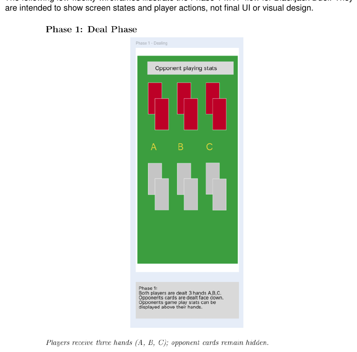
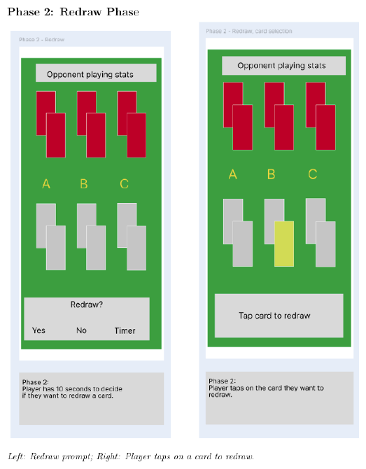
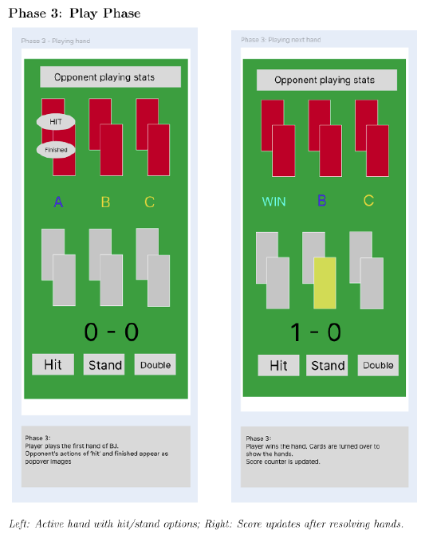

# Blackjack Duel: Game Design

## Core concept

A head-to-head PvP game built on familiar Blackjack rules: a tense, fast three-hand battle of wits, resource management and bluffing. It sits where casino and poker meet, combining the psychological strategy of heads-up poker with the simple, fast scoring of Blackjack.

## Who it's for

- **Primary:** online Blackjack players who want deeper strategy and a higher skill ceiling.
- **Secondary:** online poker players looking for a faster two-player game to fill downtime between sessions.
- **Key use case:** a "companion game" for poker players: a five-minute PvP duel while waiting for a tournament to start.

## Experience pillars

- **Strategic duel.** Every decision is a counter-play against a live opponent, not a static house dealer. Skill and strategy drive the result.
- **Calculated risk.** Players make high-stakes decisions with limited resources, incomplete information and a clock running.
- **Psychological warfare.** The hidden bust turns each hand into a test of nerve that rewards bluffing and reading your opponent.

## What makes it different

- **Play the player, not the house.** Blackjack against a dealer is a solved game of probability. Against a person, it becomes a contest of skill.
- **Meaningful strategic choice.** Two single-use abilities, Redraw and Double, create a resource puzzle that is simple to learn and hard to master.
- **Bluffing comes to Blackjack.** The hidden bust adds a layer of tension the genre has never had.

## Core loop (1v1 duel)

1. **Deal.** Each player gets three private two-card hands: A, B and C. Redraw and Double refresh for the round. A Natural Blackjack is an automatic win.
2. **Strategise.** In a timed phase before any cards are played, each player can Double one hand and Redraw one card in another.
3. **Play.** Players play Hand A against each other (unless it's Doubled or a Natural), hitting until they choose to stand. Then Hand B, then Hand C.
4. **Score.** Hands are revealed. The better hand wins 1 point, or 2 if it was Doubled.
5. **Winner.** Most points after three hands wins the round. A tie goes to Sudden Death.

## Ruleset (Phase 1)

| Term | Rule |
|---|---|
| **Hand** | One 1v1 contest played with one set of cards, such as Hand A. |
| **Round** | The full best-of-three match: Hands A, B and C. |
| **Win** | Your total beats your opponent's without busting, or your opponent busts and you don't. 1 point, or 2 if Doubled. |
| **Push** | Both totals are equal. No points. |
| **Loss** | Your total is lower, or you bust and your opponent doesn't. |
| **Natural Blackjack** | 21 dealt in the Deal Phase (Ace + a ten-value card) is an automatic win. It's revealed to the opponent, scores 1 point, can't be Doubled, and is skipped in the Play Phase. If both players have one, it's a Push. |
| **Double** | Once per round, in the Strategy Phase. Makes one hand worth 2 points. The hand takes one more card and is then locked: no hits, no Redraw. Can't be used on a Natural or on a hand that has been Redrawn. |
| **Redraw** | Once per round, in the Strategy Phase. Discard one card from one hand and draw a replacement. Can't be used on a Doubled hand. |
| **Sudden Death** | If the round is tied, each player is dealt one new hand. Double isn't available, but Redraw is, so Sudden Death stays a test of skill rather than a coin flip. A Natural wins it outright. If the hand is tied, including two Naturals or two busts, a new Sudden Death hand is dealt, until there's a winner. |
| **Hidden Bust** | When your hand goes over 21, your opponent isn't told and your turn doesn't end. You can keep hitting, as a bluff, until you choose to stand. Your bust is only revealed at the end of the hand. |

## Roadmap

**Phase 1: MVP, the 1v1 duel.** The ruleset above, with a server-authoritative game, simple matchmaking, and basic win/loss stats. See [user-stories.md](user-stories.md).

**Phase 2: engagement (tournament and social).**
- *King of the Hill:* an 8-player sit-and-go knockout tournament, turning the duel into a sport to master.
- *Player profile card:* win/loss stats, tournament trophies and collected tokens, as the foundation of a social layer.

**Phase 3: a collectible token economy.** Rare, single-use Game Tokens earned through tournaments and achievements that add social or strategic twists without breaking balance.
- *Nemesis Token:* the loser stakes it to challenge the winner to a rematch for keeps.
- *Swapsies Token:* swap one of your unplayed hands with one of your opponent's.

**Phase 4: rule experiments.**
- Allow Redraw and Double on the same hand. A clear candidate for an A/B test.
- Let Double lock a hand as it stands, with no extra card. The opponent is told which hand was Doubled, so Doubling a weak hand becomes a bluff that pushes them to chase 21. The risk: Doubling a dealt 19 or 20 becomes close to free points. Test it against the standard one-card Double.
- A per-player time bank instead of fixed turn timers, to add strategic pressure.

**Beyond:** the duel framework works for other games. Baccarat and Hi-Lo could run in the same 1v1 format.

## Wireframes

Low-fidelity wireframes for the Phase 1 flow. They show screen states and player actions, not final visual design.

| Deal | Redraw | Play |
|---|---|---|
|  |  |  |
